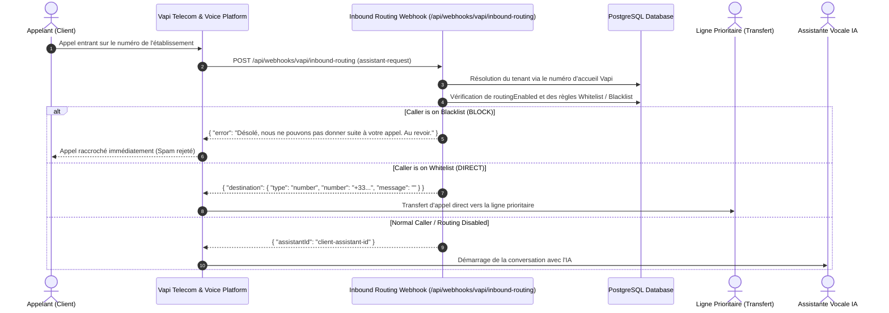

# 🔀 Vapi Inbound Call Routing & Pre-Assistant Filtering Guide

This document describes how to configure, deploy, and maintain **Multi-Tenant Call Routing** in the AI Calling System using Vapi's `assistant-request` event.

---

## 1. Overview & Architecture

Vapi allows dynamic assistant selection and call interception before the voice assistant starts, using the **Phone Number Server URL** and the **`assistant-request`** event.



---

## 2. Server URL Precedence & Event Propagation

Vapi handles Server URLs at multiple levels:
1. **Phone Number Level (Server URL)**:
   - Evaluated first when an incoming call hits a phone number.
   - If configured and the phone number's `assistantId` is null (or dynamic), Vapi dispatches `assistant-request`.
2. **Assistant Level (Server URL)**:
   - Configured on the specific assistant (e.g., Cabinet Michelle Assistant, Dani Bâtiment Assistant).
   - Receives mid-call tool calls (`tool-calls`), function calls, and post-call reports (`end-of-call-report`).

> [!IMPORTANT]
> **Preserving Existing Post-Call Processing**:
> Pointing the Phone Number Server URL to `/api/webhooks/vapi/inbound-routing` handles the pre-call routing (`assistant-request`).
> Ensure your Assistant configurations (`Cabinet Michelle` and `Dani Bâtiment`) continue to have their respective Server URLs pointing to:
> - Cabinet Michelle: `https://ai-calling-system.hassenbenhadjhassen.com/api/webhooks/vapi/patient-intake`
> - Dani Bâtiment: `https://ai-calling-system.hassenbenhadjhassen.com/api/webhooks/vapi/dani-batiment`
> 
> In addition, our `/api/webhooks/vapi/inbound-routing` endpoint is built to safely ignore non-routing event types with a `200 OK`, ensuring zero interference with other telemetry.

---

## 3. Step-by-Step Vapi Dashboard Configuration

### Step 3.1: Configure Phone Number Server URL
1. Log in to the [Vapi Dashboard](https://dashboard.vapi.ai/).
2. Navigate to **Phone Numbers** in the left sidebar.
3. Click on the incoming phone number for the business (e.g. `+33 9 39 03 36 63` for Cabinet Michelle, or `+33 9 39 03 64 62` for Dani Bâtiment).
4. In the Phone Number configuration modal:
   - **Assistant**: Set to `None` / `null` (or leave unassigned to enable dynamic `assistant-request` webhook routing).
   - **Server URL**: Set to:
     ```text
     https://ai-calling-system.hassenbenhadjhassen.com/api/webhooks/vapi/inbound-routing
     ```
   - **Server URL Secret**: Set to your configured `VAPI_WEBHOOK_SECRET` value from `.env`.
5. Click **Save Changes**.

### Step 3.2: Verify Webhook Authentication
The webhook expects either:
- Header: `Authorization: Bearer <VAPI_WEBHOOK_SECRET>`
- Or Header: `x-vapi-secret: <VAPI_WEBHOOK_SECRET>`

When you set the **Server URL Secret** in the Vapi Phone Number settings, Vapi automatically sends `x-vapi-secret`.

---

## 4. Testing & Verification Scenarios

### Test 1: Blacklisted Number (Spam Rejection)
1. In the Dashboard under **Routage & Filtrage**, select the business.
2. Ensure **Filtrage Actif** is ON.
3. Click **+ Ajouter Blacklist** and enter test phone number `+33600000001` with label "Test Spam".
4. Call the Vapi phone number from `+33600000001`.
5. Expected behavior:
   - The webhook returns HTTP 200 with `{ "error": "Désolé, nous ne pouvons pas donner suite à votre appel. Au revoir." }`.
   - Vapi terminates the call immediately without spinning up the voice assistant.
   - The caller is disconnected and no assistant charges are incurred.

### Test 2: Whitelisted Number (Direct Transfer)
1. Set the **Ligne de Transfert Prioritaire** in the dashboard (e.g. `+33612857915`).
2. Click **+ Ajouter Whitelist** and enter test phone number `+33600000002` with label "Médecin / Directeur".
3. Call the Vapi phone number from `+33600000002`.
4. Expected behavior:
   - The webhook returns HTTP 200 with:
     ```json
     {
       "destination": {
         "type": "number",
         "number": "+33612857915",
         "message": ""
       }
     }
     ```
   - Vapi immediately initiates call forwarding / transfer to `+33612857915`.
   - The AI assistant is completely bypassed.

### Test 3: Normal Caller (AI Assistant)
1. Call from any phone number that is neither in Whitelist nor Blacklist (e.g. `+33612850999`).
2. Expected behavior:
   - The webhook returns HTTP 200 with `{ "assistantId": "97808c43-384a-4f40-a8dd-9149ba4988f5" }`.
   - The normal AI voice assistant answers and greets the caller.

### Test 4: Routing Disabled
1. Turn OFF the master switch (**Activer le filtrage** $\rightarrow$ Désactivé).
2. Call from a blacklisted or whitelisted number.
3. Expected behavior:
   - The webhook immediately returns `{ "assistantId": "..." }`.
   - All rules are bypassed and all callers reach the AI assistant.

---

## 5. Troubleshooting & Healthcheck

You can check the health and reachability of the routing endpoint at any time with a simple `GET` request:
```bash
curl https://ai-calling-system.hassenbenhadjhassen.com/api/webhooks/vapi/inbound-routing
```

Response:
```json
{
  "status": "ok",
  "endpoint": "/api/webhooks/vapi/inbound-routing",
  "event": "assistant-request",
  "message": "Vapi Inbound Call Routing Webhook is active."
}
```
